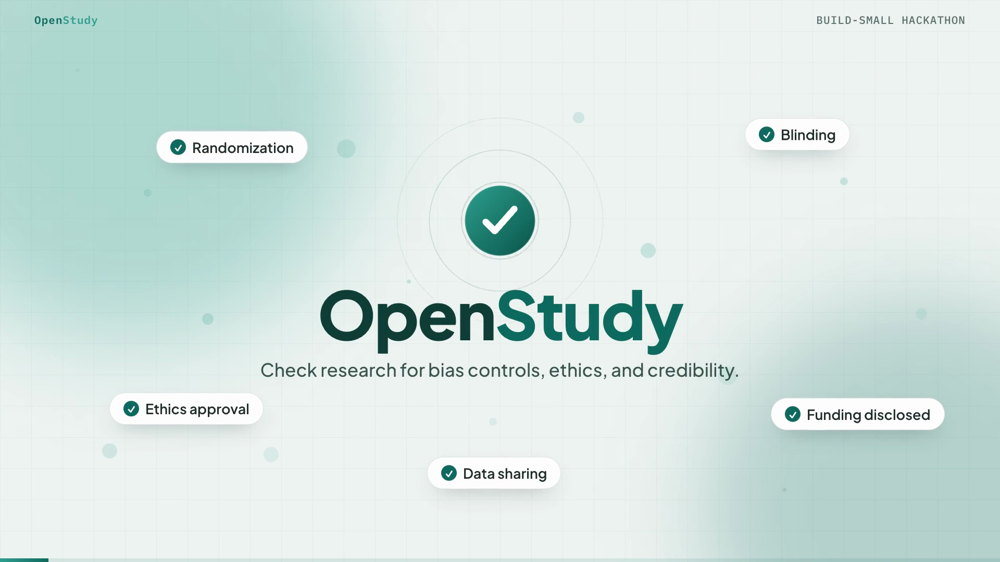

# OpenStudy

OpenStudy is an open-source Gradio app for screening research studies for reported bias controls, study conduct details, ethics safeguards, funding disclosures, and transparency signals.

## Demo video

A full walkthrough of OpenStudy in action (2 minutes, 25 seconds), with a locally generated voice-over.

<video controls width="100%" poster="https://huggingface.co/spaces/build-small-hackathon/openStudy/resolve/main/media/openstudy-demo-poster.png">
  <source src="https://huggingface.co/spaces/build-small-hackathon/openStudy/resolve/main/media/openstudy-demo.mp4" type="video/mp4">
</video>

If the player does not load, use the poster below or the direct links:

[](https://huggingface.co/spaces/build-small-hackathon/openStudy/resolve/main/media/openstudy-demo.mp4)

- In this repository: [media/openstudy-demo.mp4](media/openstudy-demo.mp4)
- On the Space: [openstudy-demo.mp4 (direct)](https://huggingface.co/spaces/build-small-hackathon/openStudy/resolve/main/media/openstudy-demo.mp4)

## What you can do

- Search public study metadata by DOI, URL, title, or keywords, returning at least 15 papers per topic when public metadata sources have enough matches, and evaluate a result with one click.
- Evaluate abstracts and available metadata from public sources, with plain-language explanations of what every score and category means.
- Define your own screening standards and parameters (categories that count, safeguards that must be reported, a minimum score, adjustable risk thresholds, and custom required terms) and get a pass or fail verdict against them on every evaluation.
- Add your own research study (PDF, DOCX, text, or pasted manuscript) to screen it for bias-control and credibility safeguards against those standards.
- Upload your own research projects, protocols, benchmark plans, or preregistrations to review planned conduct before or during a study.
- Keep an in-session project dashboard and export project summaries as JSON.
- Run an optional Qwen agent review using `Qwen/Qwen3.6-27B` only.
- Download a Markdown report with evidence snippets and follow-up questions.

## Required AI model

OpenStudy's AI review path is restricted to `Qwen/Qwen3.6-27B` only. It does not fall back to another model.

For Hugging Face Spaces, configure a Space secret named `HF_TOKEN` with access to the model or paste a temporary token into the Qwen review control in the app.

## Important limitation

OpenStudy is a decision-support checklist. It flags what appears to be reported or missing in the supplied text. It does not certify that a study is ethical, unethical, biased, unbiased, valid, or invalid.

## Run locally

```bash
pip install -r requirements.txt
python app.py
```

## Deploy on Hugging Face Spaces

Create a new Space using the Gradio SDK, then upload this repository. Hugging Face Spaces installs `requirements.txt` and runs `app.py`.

## Build Small Hackathon

OpenStudy is an entry in the [Hugging Face Build Small Hackathon](https://huggingface.co/build-small-hackathon) (Gradio and Hugging Face, June 2026), shipped under the `build-small-hackathon` organization.

How it meets the three core constraints:

- **Small model only (under 32B):** the only AI review path is `Qwen/Qwen3.6-27B`, a 27B model that is well within the 32B parameter cap. There is no fallback to a larger model.
- **Gradio required:** the entire experience runs through a single Gradio app on a Hugging Face Space, with search, uploads, tables, plots, downloads, and reports all exposed as Gradio components.
- **Show, do not tell:** the 2 minute 25 second demo video above shows real lookups, real evaluations, and real verdicts.

### Track and bonus badges

- **Track: Backyard AI.** OpenStudy solves a concrete, everyday problem for real people: students, lab members, peer reviewers, and independent researchers who need to see, quickly and transparently, which safeguards a study actually reports before they trust it or submit it.
- **Bonus badge: Off-Brand.** The interface is a fully custom front end built on top of Gradio, with a bespoke theme, a design-system stylesheet, a custom HTML hero, and styled result plots, rather than the default Gradio look.
- **Bonus badge: Field Notes.** The development report is in the section below.
- **Also submitted for: Best Demo,** with the video above.

### Field Notes (development report)

**The problem.** Preprints and published papers rarely make it obvious whether a study reports the basics that make research trustworthy: randomization and blinding, ethics approval and consent, funding and conflict-of-interest disclosures, data and code sharing, and stated limitations. Readers usually have to hunt for these by hand. OpenStudy turns that hunt into a fast, transparent checklist.

**How it works.** Scoring is rule-based and transparent, not a black box. Every safeguard is marked reported, a potential concern, or missing, each category score is the share of credit earned, and every signal comes with evidence quoted from the actual text plus a suggested next check. Users can lift or lower the bar by setting their own categories, required safeguards, minimum score, and risk thresholds, and each evaluation returns a clear pass or fail against those standards.

**The tech.** OpenStudy is a Gradio app on Hugging Face Spaces. Paper lookup pulls metadata and abstracts from public sources, uploads are parsed from PDF, DOCX, and plain text, and an optional agent review is restricted to `Qwen/Qwen3.6-27B` through Hugging Face Inference. Results export as a Markdown report with evidence snippets and as JSON. Nothing is stored after the session.

**About the demo video.** The walkthrough was produced locally. The narration uses a local neural text-to-speech voice (Piper), the on-screen product footage is captured from the real running app, and the motion graphics were rendered deterministically frame by frame so the audio and video stay in sync.
